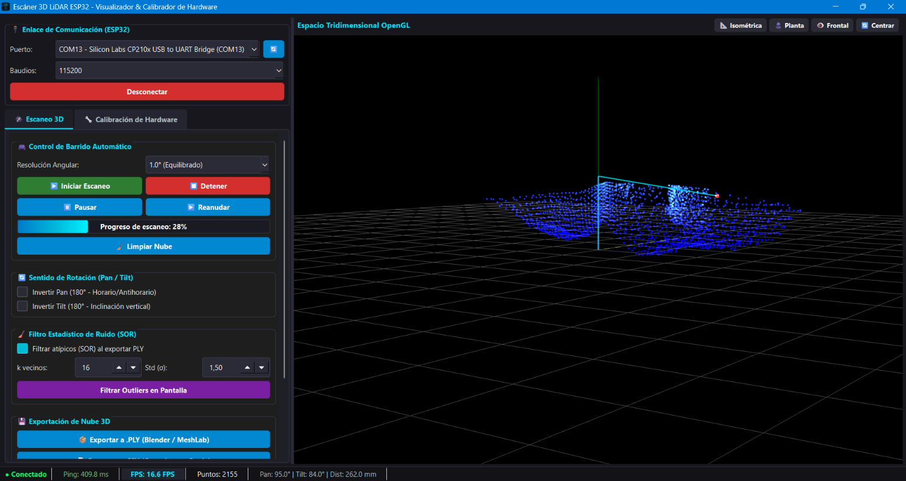
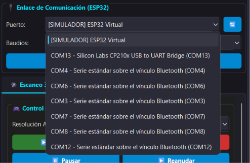
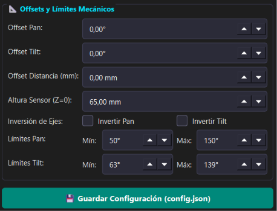
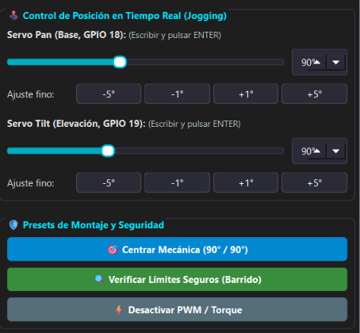
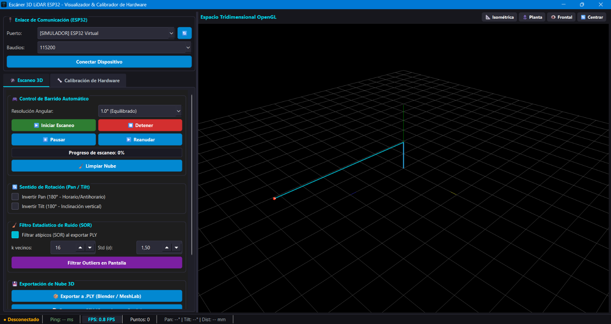

# 🛰️ Escáner 3D LiDAR ESP32 - Visualizador & Calibrador de Hardware

Sistema integral de digitalización tridimensional y visualización en tiempo real basado en microcontrolador **ESP32**, servomotores de alto torque **MG996R** en configuración Pan-Tilt, sensor láser Time-of-Flight (**VL53L0X**) y una aplicación de escritorio de alto rendimiento desarrollada en **Python 3**, **PyQt6** y **OpenGL** (`pyqtgraph`).

---

## 📐 Arquitectura del Sistema

El sistema opera bajo una arquitectura desacoplada y reactiva dividida en dos capas principales:

1. **Capa Embebida (Firmware ESP32):**
   - Control de posición angular de precisión mediante modulación PWM nativa por hardware (**LEDC** a 50 Hz con resolución de 14 bits).
   - Adquisición de distancia milimétrica en tiempo de vuelo (ToF) mediante el sensor **VL53L0X** a través de bus **I2C Fast Mode** (400 kHz).
   - Protocolo de comandos seriales no bloqueante a 115200 bps con patrón de escaneo matricial tipo *Boustrophedon* (zigzag continuo).

2. **Capa de Aplicación (Software de Escritorio PyQt6):**
   - Hilo secundario asíncrono (`QThread`) para recepción serial con protección atómica contra desconexiones físicas de cable USB.
   - Transformación cinemática esférica a cartesiana con compensación geométrica de cota de sensor ($Z = 65\text{ mm}$) y horizonte en $90^\circ$.
   - Renderizado acelerado por GPU mediante OpenGL (`GLViewWidget`) con visualizador de FPS en tiempo real.
   - Filtro de reducción de ruido estadístico (**SOR - Statistical Outlier Removal**) vectorizado con NumPy.
   - Pestaña de calibración física con controles de Jogging validados exclusivamente mediante la tecla ENTER para proteger la mecánica de los servomotores.

```
       +---------------------------------------------+
       |             SENSOR VL53L0X (I2C)            |
       +----------------------+----------------------+
                              |
       +----------------------v----------------------+
       |          SERVOMOTORES MG996R (PWM)          |
       |            Pan (GPIO 18) | Tilt (GPIO 19)   |
       +----------------------+----------------------+
                              |
       +----------------------v----------------------+
       |               ESP32 DevKit V1               |
       |   Firmware C++ / LEDC 14-bit / 115200 bps   |
       +----------------------+----------------------+
                              | (USB Serial / COM)
       +----------------------v----------------------+
       |        SerialController (PyQt6 QThread)     |
       +----------------------+----------------------+
                              |
       +----------------------v----------------------+
       |        LidarScannerGUI (OpenGL 3D)          |
       |   - Calibrador de Hardware en Vivo          |
       |   - Filtro Estadístico SOR                  |
       |   - Exportador PLY (RGB) y CSV              |
       +---------------------------------------------+
```

---

## 🔌 Tabla de Conexiones de Hardware (Pinout)

> [!IMPORTANT]
> Los servomotores **MG996R** pueden demandar picos de corriente superiores a **1.5 A - 2.5 A** bajo carga. **Nunca** alimentes los servos directamente desde la salida de 5V o 3.3V del ESP32 o el puerto USB de la computadora. Utiliza una fuente de alimentación externa de **5V a 6V (3A mínimo)** con masa compartida (GND común).

| Componente | Pin / Señal | Pin ESP32 | Descripción Eléctrica / Función |
| :--- | :--- | :--- | :--- |
| **Servo PAN** | Señal (Naranja/Amarillo) | **GPIO 18** | Señal PWM LEDC (50 Hz, 14 bits) - Giro horizontal |
| **Servo PAN** | VCC (+) (Rojo) | **Ext 5V-6V** | Alimentación externa de potencia (+5V a +6V DC) |
| **Servo PAN** | GND (-) (Marrón/Negro) | **GND Común** | Tierra compartida de servos y ESP32 |
| **Servo TILT** | Señal (Naranja/Amarillo) | **GPIO 19** | Señal PWM LEDC (50 Hz, 14 bits) - Elevación vertical |
| **Servo TILT** | VCC (+) (Rojo) | **Ext 5V-6V** | Alimentación externa de potencia (+5V a +6V DC) |
| **Servo TILT** | GND (-) (Marrón/Negro) | **GND Común** | Tierra compartida de servos y ESP32 |
| **VL53L0X** | SDA | **GPIO 21** | Línea de datos bidireccional I2C |
| **VL53L0X** | SCL | **GPIO 22** | Línea de reloj I2C (400 kHz Fast Mode) |
| **VL53L0X** | VIN / VCC | **3.3V / 5V** | Alimentación lógica desde placa ESP32 |
| **VL53L0X** | GND | **GND** | Tierra del sensor conectada al ESP32 |

---

## 🚀 Instalación y Preparación

### 1. Requisitos Previos
- Windows 10 u 11 (64 bits).
- Python 3.10 o superior instalado y agregado al `PATH`.
- Controladores USB instalados para tu placa ESP32 (CP2102, CH340 o FTDI).

### 2. Clonación y Configuración del Entorno Virtual
Abre una terminal PowerShell en el directorio del proyecto:

```powershell
# 1. Crear entorno virtual
python -m venv venv

# 2. Activar entorno virtual
.\venv\Scripts\activate

# 3. Actualizar pip e instalar dependencias
pip install -r requirements.txt
```

### 3. Carga del Firmware en el ESP32
1. Abre el archivo [`firmware/esp32_lidar_scanner.ino`](file:///firmware/esp32_lidar_scanner.ino) en **Arduino IDE** o **PlatformIO**.
2. Desde el Gestor de Librerías, instala la biblioteca:
   - `Adafruit_VL53L0X` (de Adafruit).
3. Selecciona tu placa (ej. *ESP32 Dev Module*) y el puerto COM asignado.
4. Presiona **Subir** (*Upload*).

---

## 🖥️ Ejecución de la Aplicación

La aplicación está preparada para ejecutarse en modo producción sin ventanas de consola parpadeantes ni bloqueos:

### Modo Silencioso (Producción)
- **Acceso Directo de Escritorio (`Escáner 3D LiDAR.lnk`)**: Apunta directamente a `pythonw.exe` con `main.py` como argumento e icono personalizado, ejecutándose de forma 100% nativa sin abrir consolas ni pestañas en Windows Terminal (Windows 11).
- **`iniciar.bat`**: Script batch auxiliar para ejecución desatendida mediante detección automática de entornos virtuales.

### Generar o Restaurar el Acceso Directo de Escritorio
Si deseas volver a generar el acceso directo en el Escritorio del usuario actual con icono personalizado y modo silencioso:
```powershell
python crear_acceso_directo.py
```

### Modo Desarrollador (Con Salida de Consola)
Si requieres depurar la aplicación viendo trazas en tiempo real:
```powershell
.\venv\Scripts\python.exe main.py
```

---

## ⚙️ Funciones Principales y Algoritmos

### 1. Calibración en Vivo y Jogging Seguro
- **Validación Estricta con ENTER:** Los campos numéricos de ajuste angular (`EnterValidatedSpinBox`) no transmiten comandos seriales mientras el usuario digita o navega, evitando tirones mecánicos descontrolados en los servomotores. El comando solo se transmite al presionar explícitamente `ENTER` o perder el foco.
- **Debounce de Sliders:** Los controles deslizantes integran temporizadores de amortiguación (35 ms) para no saturar el canal de transmisión serial.

### 2. Límites Dinámicos, Control de Escaneo (Pausa / Reanudación) y Retorno al Centro
- Permite configurar los ángulos mínimos y máximos seguros de trabajo mecánico para Pan y Tilt (por defecto adaptados a los topes de diseño del soporte 3D: Pan: $50^\circ - 122^\circ$, Tilt: $63^\circ - 139^\circ$).
- **Pausa y Reanudación con Motores Congelados:** El comando `CMD:PAUSE_SCAN` detiene el avance y la lectura manteniendo los servomotores energizados y fijos en sus ángulos exactos. Al pulsar **Reanudar** (`CMD:RESUME_SCAN`), el escaneo continúa sin perder la posición ni reiniciar la barra de progreso.
- **Barra de Progreso Fluida y Retorno al Centro:** El firmware transmite continuamente el avance angular (incluso en zonas vacías con lectura `-1`) para avanzar la barra de progreso de `0%` a `100%` sin saltos. Al completar el volumen, ambos servos retornan automáticamente y de forma suave al centro mecánico ($90^\circ, 90^\circ$).
- Dispone de un botón de prueba de límites continuos para auditar visualmente que los cables no queden atrapados ni se sobreesfuerce el engranaje del servo antes de iniciar un escaneo de larga duración.

### 3. Compensación de Cota Z y Cinemática Esférica
La cinemática transforma las lecturas de los servos y el sensor a coordenadas cartesianas globales $(X, Y, Z)$ en milímetros:
- El horizonte horizontal se define en **$\text{Tilt} = 90^\circ$** (ángulo de elevación $\theta = \text{Tilt} - 90^\circ$).
- **Compensación de Cota de Sensor ($Z_0 = 65.0\text{ mm}$):** Corrige la altura física del centro óptico del sensor respecto a la superficie de apoyo (mesa/suelo). De este modo, la superficie de apoyo representa exactamente la cota $Z = 0\text{ mm}$:
  $$\begin{aligned}
  X &= d_{\text{eff}} \cdot \cos(\theta) \cdot \cos(\phi) \\
  Y &= d_{\text{eff}} \cdot \cos(\theta) \cdot \sin(\phi) \\
  Z &= (d_{\text{eff}} \cdot \sin(\theta)) + Z_0
  \end{aligned}$$
  *(Donde $\phi = \text{Pan}_{\text{eff}}$ y $d_{\text{eff}} = d_{\text{raw}} + \text{offset}$).*

### 4. Filtro Estadístico de Ruido (SOR - Statistical Outlier Removal)
- Elimina reflexiones especulares erráticas y ruido de borde propio de los sensores ópticos ToF.
- Implementado con **NumPy puramente vectorizado por bloques**, calcula la distancia media de cada punto a sus $k$ vecinos más cercanos ($k=16$) y descarta aquellos cuya distancia exceda $\mu + \alpha \cdot \sigma$ (por defecto $\alpha = 1.5$).
- Procesa miles de puntos en milisegundos sin requerir compiladores de C++ ni librerías pesadas como Open3D/PCL.

### 5. Exportación Estándar de Nubes de Puntos
- **Archivo PLY (Polygon File Format):** Exporta la nube de puntos con encabezado ASCII estándar y asignación de color RGB en gradiente según la elevación en el eje $Z$, listo para abrir directamente en **CloudCompare**, **MeshLab**, **Blender** o suites de ingeniería inversa.
- **Archivo CSV Tabular:** Almacena la matriz completa con encabezados: `X_mm, Y_mm, Z_mm, Pan_eff, Tilt_eff, Dist_raw_mm, Dist_eff_mm`.

### 6. Simulador Virtual ESP32 Incorporado
- Al seleccionar el puerto **`[SIMULADOR] ESP32 Virtual`**, el software genera un gemelo digital sintético que emula la cinemática de los servomotores y proyecta un objeto virtual tridimensional para pruebas completas de GUI, calibración y renderizado sin necesidad de contar con el hardware físico enchufado.

---

## 📁 Estructura del Repositorio

```
Proyecto LIDAR app/
├── assets/
│   ├── lidar_icon.ico           # Icono multi-resolución de Windows (16 a 256 px)
│   └── lidar_icon.png           # Icono de alta resolución en formato PNG
├── exports/
│   └── .gitkeep                 # Carpeta para guardado de nubes de puntos (.ply/.csv)
├── firmware/
│   └── esp32_lidar_scanner.ino  # Código embebido ESP32 (LEDC 14-bit, I2C, Serial)
├── calibration_widget.py        # Pestaña y widgets interactivos de calibración
├── config_manager.py            # Gestor atómico de configuración JSON
├── config.json                  # Parámetros mecánicos y de calibración persistentes
├── crear_acceso_directo.py      # Script de generación de acceso directo en Escritorio
├── iniciar.bat                  # Lanzador silencioso sin consola cmd (pythonw)
├── main.py                      # Punto de entrada y ventana principal OpenGL
├── requirements.txt             # Dependencias del proyecto
├── .gitignore                   # Exclusiones de control de versiones
└── README.md                    # Documentación del proyecto
```

---

## Capturas de la Aplicación

### Interfaz Principal y Funcionamiento


### Conexión de Puerto Serial (COM)


### Calibración, Límites Mecánicos y Centro de Trabajo





```

---

## 📄 Licencia

Este proyecto se distribuye bajo los términos de la Licencia MIT. Consulta el archivo correspondiente para más detalles.

